# Bingr

[](https://github.com/LRvdLinden/iptv-ios-appletv/actions/workflows/build.yml)

Native IPTV- en mediaspeler voor **iPhone, iPad, Mac en Apple TV** met de look & feel van Netflix.
SwiftUI · iOS 17+ · tvOS 17+ · macOS 14+ · Apple- én VLC-engine · 11 talen · versie 1.0.0 (build 38).

## Screenshots

> Ontwerp-previews van de schermen (gerenderd vanuit `docs/mockups/mockups.html`, met fictieve titels en zenders). Worden vervangen door echte simulator-screenshots zodra de app draait.

### iPhone

| Splash | Wie kijkt er? | Home |
|:---:|:---:|:---:|
| 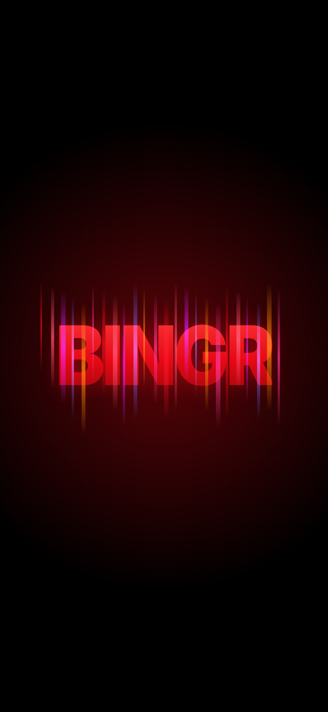 | 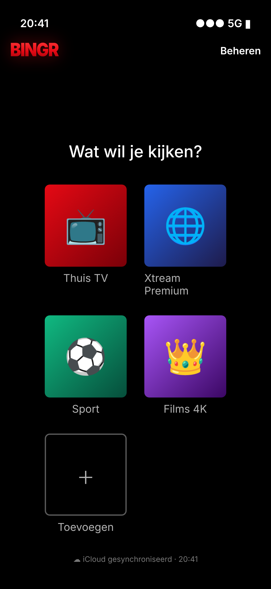 | 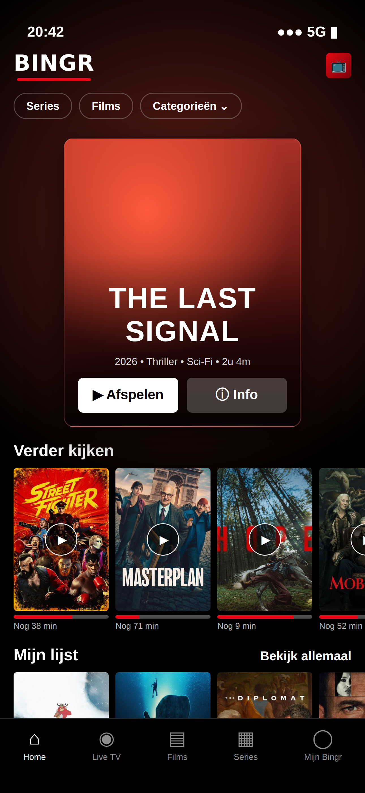 |
| **Details** | **Details: scores, cast, aanbevelingen** | **Live TV** |
| 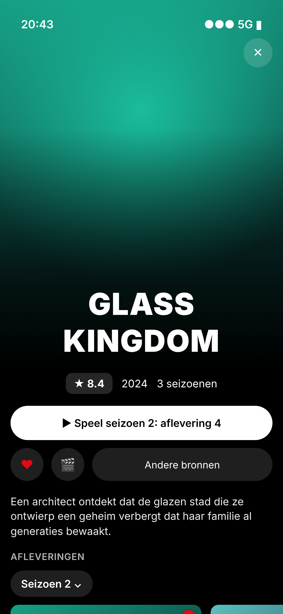 | 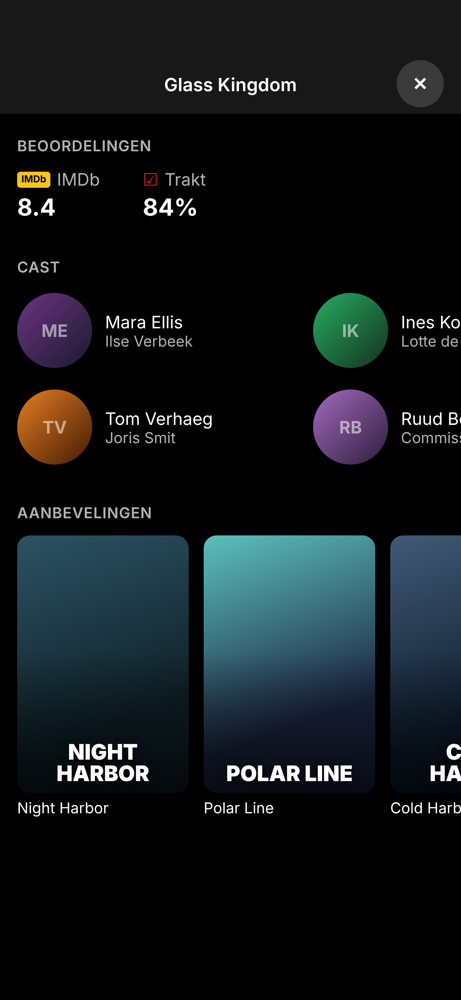 | 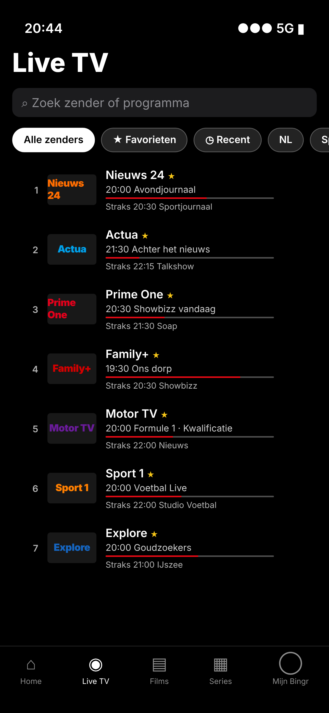 |
| **Tv-gids** | **Top 10 (Netflix-stijl)** | **Bekijk allemaal** |
| 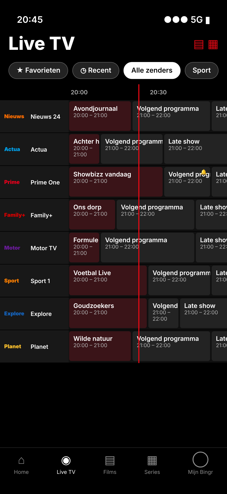 | 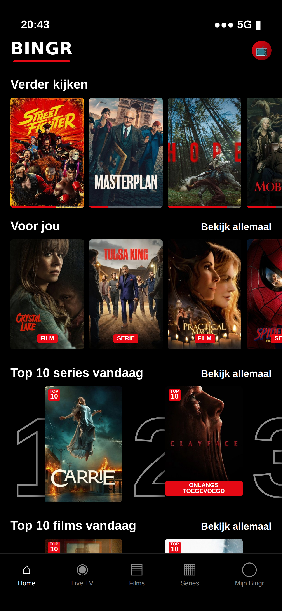 | 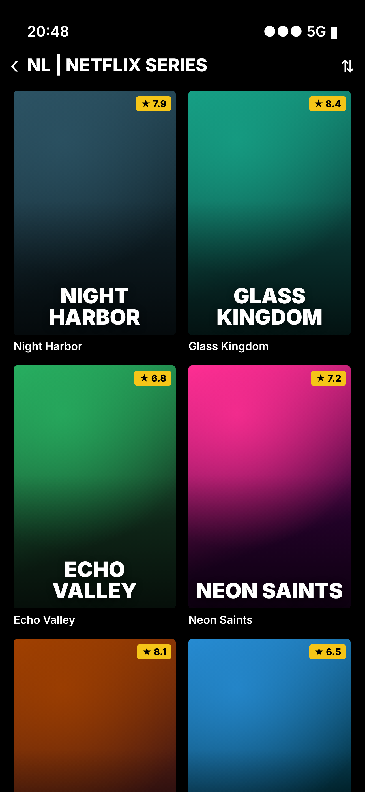 |
| **Server toevoegen** | **Mijn Bingr** | **Categorieën aan/uit** |
| 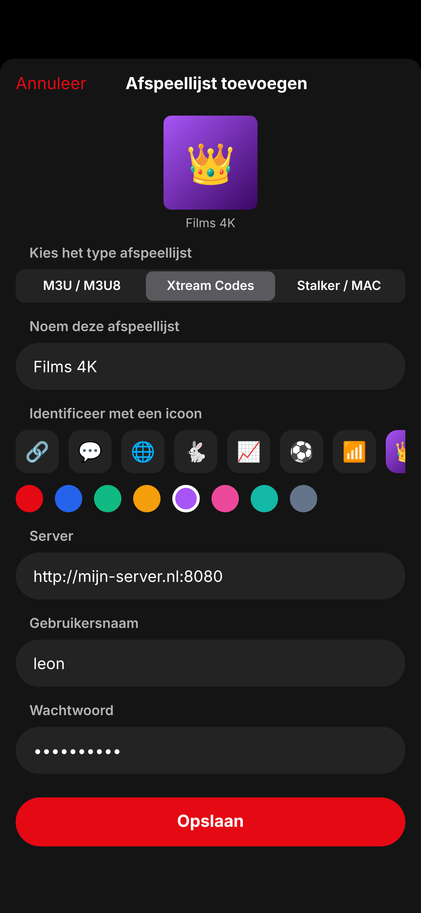 | 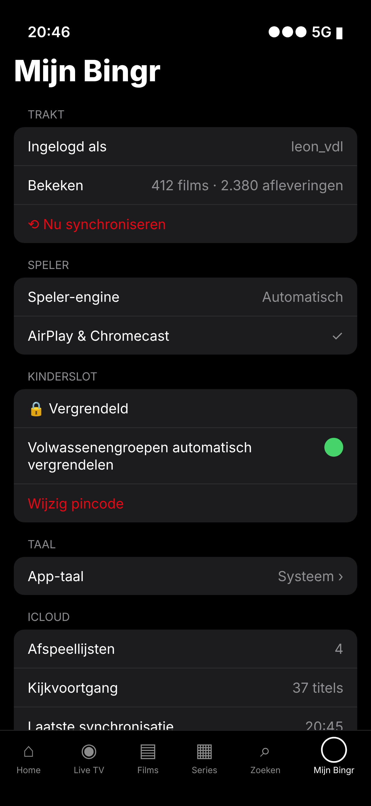 | 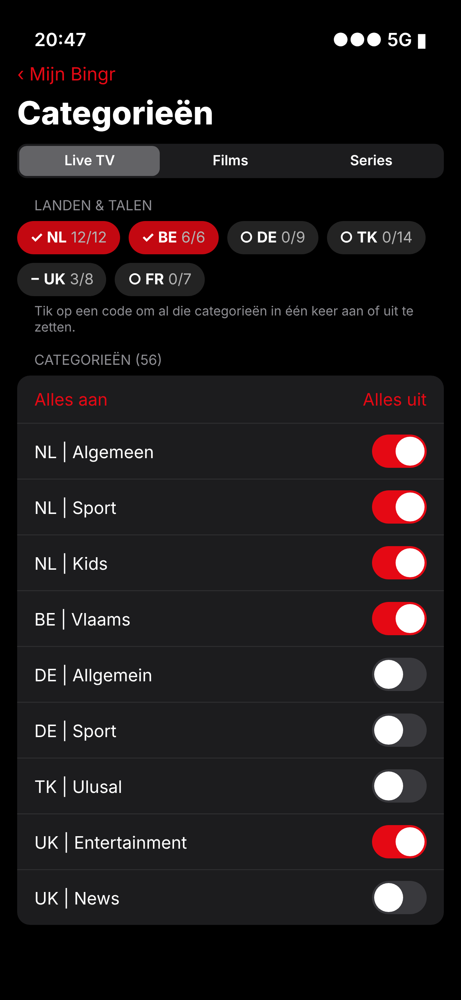 |

### Apple TV

| Home | Wie kijkt er? |
|:---:|:---:|
| 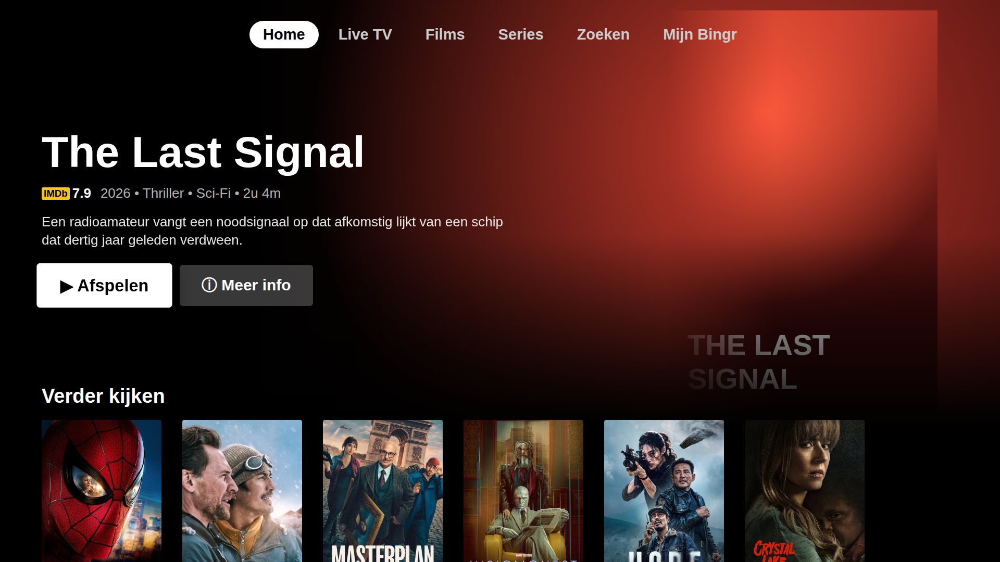 | 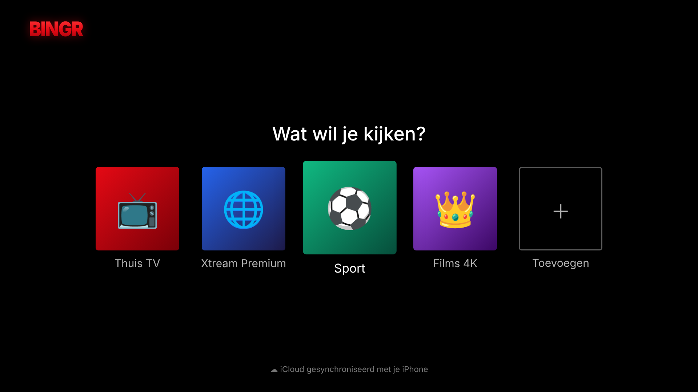 |
| **Serie + afleveringen** | **Live TV** |
| 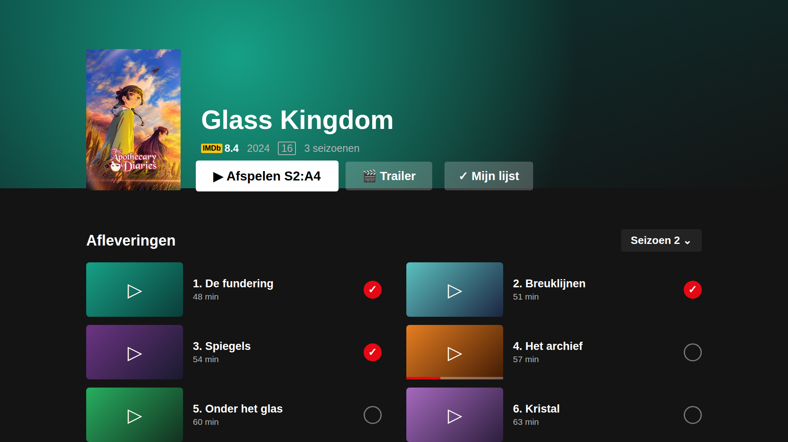 | 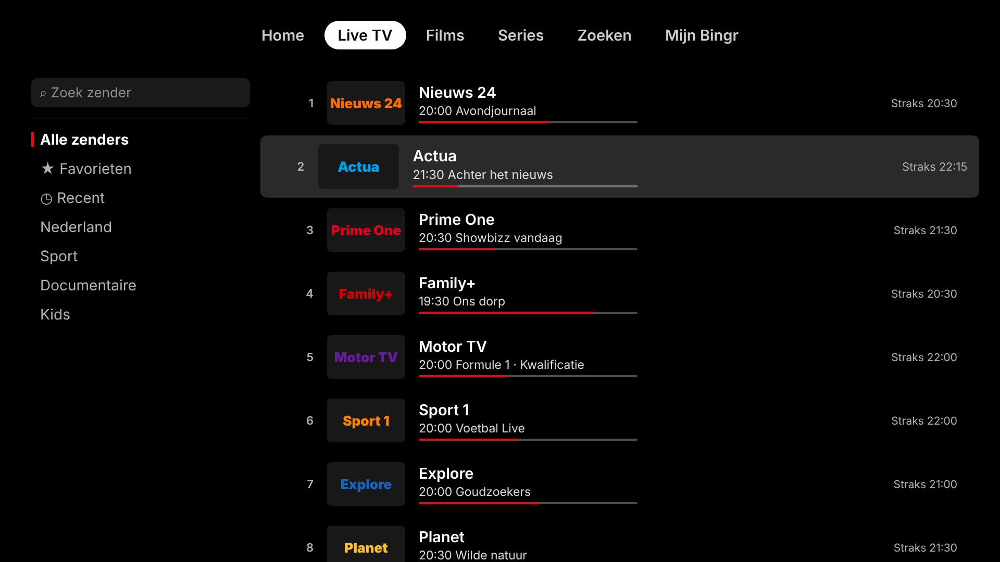 |
| **Tv-gids** | **Multiview** |
| 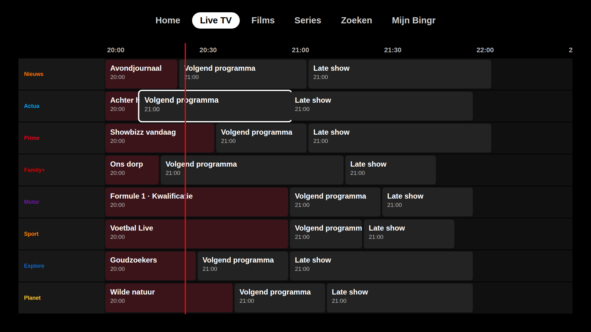 | 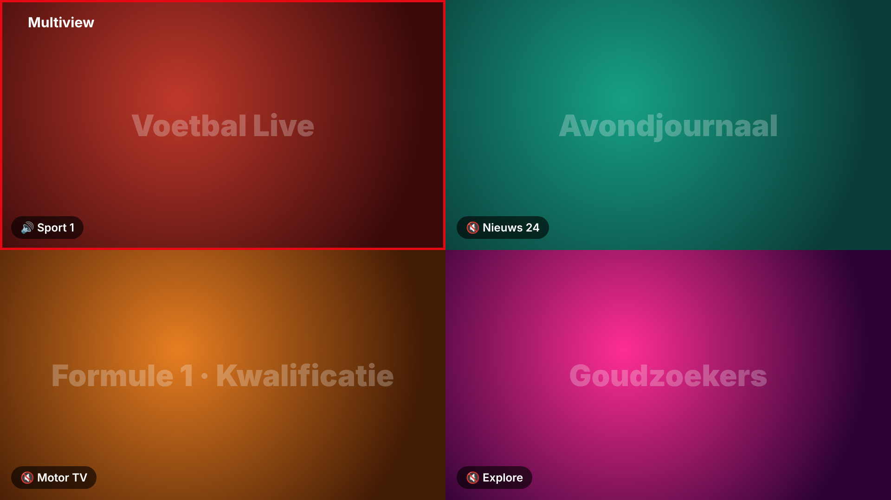 |
| **Trakt koppelen** | |
| 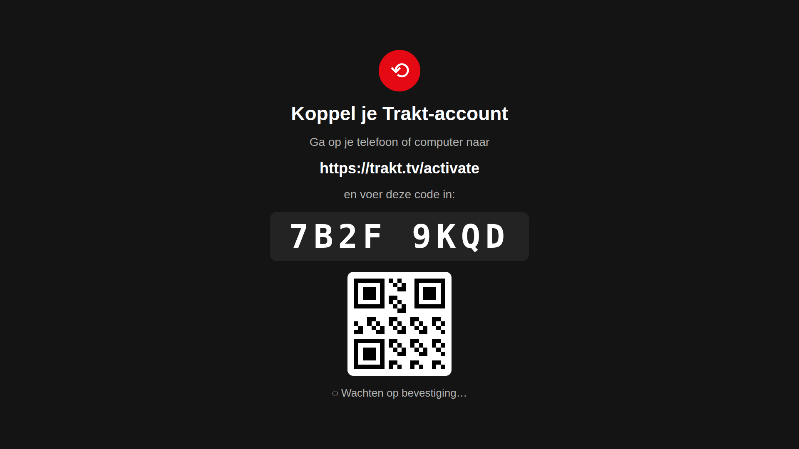 | |

### Mac

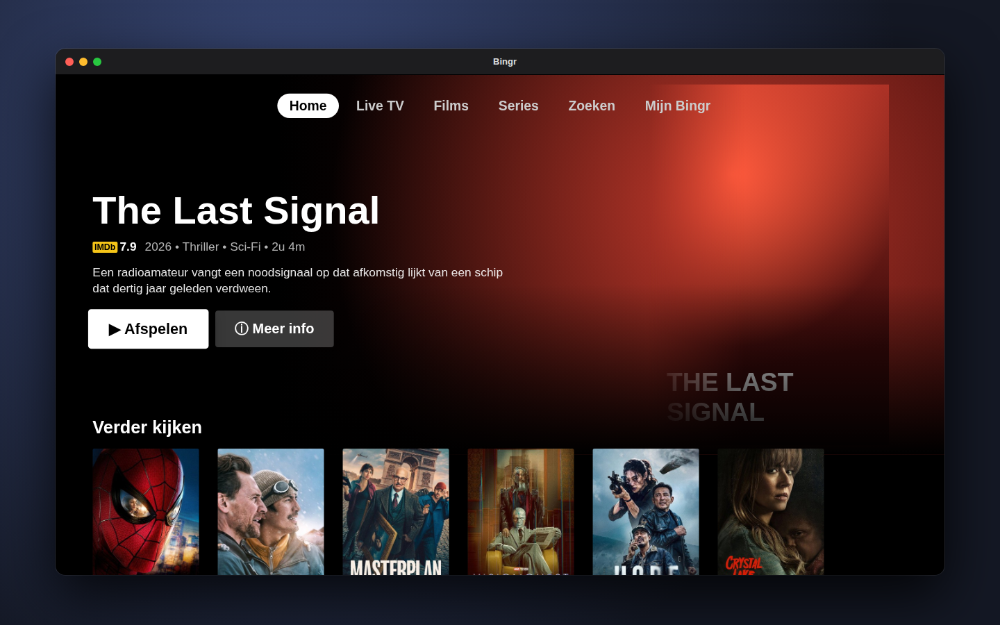

## Functies

**Account**
- **Verplicht inloggen** met een Bingr-account (e-mail + wachtwoord), zoals Netflix: splash → inlogscherm → "Wie kijkt er?". Met een geldige sessie ga je meteen door; account maken, wachtwoord vergeten, uitloggen en account verwijderen in de app (Mijn Bingr → Account)
- **QR-koppeling op Apple TV**: scan de QR-code met je telefoon of ga naar **bingr.online/tv** en voer de code in; of log op de tv in met e-mail. Op iPhone, iPad en Mac koppel je een tv met *Mijn Bingr → Account → Tv koppelen*
- **Profielen bij je account**: bij de eerste login worden je bestaande profielen aan je account gekoppeld (niets gaat verloren) en gedeeld met de Android-app. Pincodes en eigen foto's blijven op je apparaten
- De sessie staat alleen op dit apparaat (sleutelhanger zonder iCloud-sync); offline blijft de app gewoon werken

**Bronnen**
- M3U/M3U8 + XMLTV-EPG, **Xtream Codes** (incl. catch-up), **Stalker/MAC-portal**
- **Plex** (inloggen met code op plex.tv/link), **Jellyfin**, **Emby** (films, series, live TV + gids)
- **Stremio**: inloggen met je Stremio-account of eigen add-on-URL's (Cinemeta-catalogi, directe streams)
- **Eén hoofdaccount, meerdere profielen**: alleen het hoofdaccount (rood rondje met poppetje) stelt de server, Trakt, OpenSubtitles, kinderslot en categorieën in en maakt profielen aan. Elk profiel gebruikt dezelfde server maar heeft **volledig eigen gegevens**: Mijn lijst, Verder kijken, Voor jou, favorieten, bekeken, kijkgeschiedenis en leeftijdsgrens (Trakt hoort bij het hoofdaccount). Eigen **naam, avatar (icoon, een van 16 getekende figuurtjes of een eigen foto)**, eigen **pincode** en eigen kijkvoorkeuren (automatische ondertitels, ondertitel- en audiotaal) per profiel. Wisselen via je avatar of Mijn Bingr
- **Zoeken in al je afspeellijsten** tegelijk: films, series, zenders, **categorieën** en de **tv-gids** (nu, straks en terugkijken). Ook via het vergrootglas op Home, Films en Series, en dan altijd door álle content
- **NAS via SMB/DLNA**: servers op je netwerk worden gevonden, of voeg zelf een SMB-share toe; bladeren en afspelen

**Kijken**
- Twee engines: **Apple (AVPlayer)** voor HLS/MP4 met **HDR, Dolby Vision, Dolby Atmos** en automatisch juiste schermmodus op Apple TV; **VLC** voor .ts, .mkv, AC3/DTS en de rest. Automatisch kiezen of zelf instellen
- **AirPlay** en **Chromecast** (zonder extra SDK), **beeld-in-beeld** op iPhone, iPad en Apple TV
- **Standaard audio- en ondertiteltaal** (automatisch gekozen als de stream ze heeft)
- **Automatisch herverbinden** bij haperende of weggevallen streams (met terugval naar de andere engine); geen stream gevonden → duidelijke melding met "Opnieuw" in plaats van een eindeloze spinner
- **Volgende aflevering** zoals Netflix: knop in de laatste 45 seconden en automatisch door naar de volgende (ook over seizoenen heen); "Verder kijken" pakt de laatst bekeken aflevering
- **Timeshift**: live tv pauzeren en terugspoelen (HLS-venster of catch-up), knop "terug naar live"
- **Multiview**: tot 4 streams tegelijk, geluid van het geselecteerde beeld
- **Ondertitelgrootte** (klein, middel, groot; ook tijdens het kijken), audio- en ondertitelsporen, **OpenSubtitles** (zoeken op IMDb-ID of titel, taal kiezen tijdens het kijken met vlaggen, standaardtaal + automatisch laden, timing verschuiven, ook niet-UTF-8-bestanden), snelheid, beeldverhouding, slaaptimer, zappen ↑↓

**Gids & beheer**
- **Tv-gids als raster** met nu-lijn, programma-details, **terugkijken** en **herinneringen** (melding op iPhone/iPad, banner op Apple TV)
- **Live TV** opent op "Alle zenders"; favorieten, recent en alle groepen. **Zoeken op Live TV** (iPhone, iPad én Apple TV) zoekt altijd door álle zenders: op naam, zendernummer, groep en wat er nu speelt
- Tv-gids-raster blijft vlot bij duizenden zenders (toont de eerste 150 van een groep, 1 uur terug t/m 13 uur vooruit)
- **Categorieën aan/uit** per Live TV, Films en Series, met snelknoppen per land/taal (NL, BE, DE, TK …)
- **Servers** toevoegen, wisselen, wijzigen en verwijderen (hoofdaccount)
- **Beheren**: groepen en zenders hernoemen, herschikken, samenvoegen en verbergen (op Apple TV via selecteren of vasthouden)
- **Pincode** per profiel (op Apple TV een compacte rij cijfers die op elk scherm past), en met de pincode van het hoofdaccount het kinderslot: groepen op slot, volwassenengroepen automatisch, **leeftijdsgrens per profiel** (IMDb-classificatie), 30 min ontgrendelen (daarna automatisch weer op slot). Een titel boven de grens met pincode afspelen ontgrendelt alleen díe titel, niet de hele bibliotheek
- **Kinderprofiel** (krijgt meteen een vrolijk figuurtje, zonder "Kids"-label bij de naam): alleen kinderzenders, tekenfilms/familie en titels met een bekende leeftijd binnen de grens (standaard t/m 12), met een eigen **Top 10 voor kids**. Bij grenzen t/m 12 jaar wordt streng gefilterd (onbekend = verborgen)
- **Gezien per profiel, ook zonder Trakt**: Bingr houdt zelf bij wat elk profiel (hoofdaccount én subprofielen) heeft gezien — vinkjes op films en afleveringen en "X GEZIEN" op series, ook als de afleveringen pas later laden
- **Kijkgeschiedenis per profiel**, per dag, met verwijderen en wissen
- **Mijn Bingr** zoals "Mijn Netflix": je profiel bovenaan (tik om te wisselen), met Verder kijken en Mijn lijst; op iPhone je profielfoto als tabbladicoon
- **Weergave**: startscherm kiezen, tabbladen verbergen, intromuziek aan/uit; alle keuzes als dropdown
- **Speler op Apple TV**: klik = bediening, ←/→ = 10 s spoelen, ↑/↓ = zappen; in de bediening navigeer je vrij naar pauze, spoelen, audio & ondertitels en opties (blijft zichtbaar zolang je rondkijkt)
- **Apple TV-bediening** zonder grijze vlakken: geselecteerde posters worden groter, knoppen wit (zoals Netflix)

**Detailpagina (UHF-stijl)**
- Grote afbeelding met titel-logo, score, jaar en speelduur/seizoenen
- Eén knop "Speel seizoen 2: aflevering 4" (gaat verder waar je was), Mijn lijst, trailer, afvinken
- **Andere bronnen**: dezelfde titel in andere groepen of afspeellijsten
- **Delen**: deelknop bij films en series (WhatsApp, iMessage, Instagram, Facebook, Mail …) met een link naar IMDb (of Trakt/TMDB) en een tekst als "Serietip: Reacher (2022)"; vasthouden = link kopiëren. Op Apple TV een QR-code om met je telefoon te scannen
- Afleveringen als kaarten met foto, voortgang, vinkje, beschrijving en uitzenddatum
- Beoordelingen (IMDb, Trakt), cast met foto's en rol, aanbevelingen (direct afspelen als ze in je lijst staan)
- Werkt zonder sleutels met de info van je Xtream-server; IMDb, Trakt en TMDB vullen aan

**Netflix-ervaring**
- Geanimeerde splash met een eigen **Bingr-intro-tune** (`tools/make_tune.py`, uit te zetten), profielkeuze met ronde avatars (op Apple TV vergroot de geselecteerde), billboard, rijen
- **Top 10 zoals Netflix** (grote omlijnde cijfers; trending vandaag via TMDB en Trakt, gekoppeld aan jouw lijst, anders je best beoordeelde titels) onder Voor jou: series en films op Home, films bij Films, series bij Series
- **Verder kijken** met voortgangsbalk en resterende tijd; aantikken geeft de keuze **Hervatten (vanaf 23:14)** of **Opnieuw bekijken** (verwijderbaar, zonder live tv), **Voor jou** (vergelijkbaar met wat je keek)
- **Mijn lijst** (hartje op de detailpagina): films én series op Home en in Mijn Bingr, per profiel; bij het hoofdaccount loopt de Trakt-watchlist mee. Favoriete zenders staan ook in Mijn Bingr
- **Bekijk allemaal** bij elke rij: categoriepagina met sorteren (A–Z, nieuwste, score) en IMDb-score per poster
- **IMDb**-score, plot, cast (via OMDb) en **trailers** (via Trakt)
- **Trakt, 2 kanten op**: koppelcode + QR, vinkjes uit Trakt in de app (ook bij IPTV-titels als "NL | Reacher (2022) 4K"), afvinken in de app → Trakt, scrobblen (vanaf 80% gezien; titels zonder IMDb-ID worden bij Trakt opgezocht), watchlist. Na het kijken worden de vinkjes direct bijgewerkt. In de speler zie je kort of Trakt meekijkt; Mijn Bingr toont de sync-status (draaiende pijltjes tijdens synchroniseren) en wat er het laatst is doorgegeven. Lukt scrobblen niet, dan zet Bingr de titel direct in je Trakt-geschiedenis

**Overal hetzelfde**
- **iCloud-sync** tussen iPhone, iPad, Mac en Apple TV: server(s), profielen met foto, per profiel favorieten, Mijn lijst en kijkvoortgang, herinneringen, aanpassingen en kinderslot; logins via de iCloud-sleutelhanger
- **11 talen**: Engels, Nederlands, Duits, Frans, Spaans, Italiaans, Portugees, Turks, Pools, Arabisch (rechts-naar-links) en Chinees. Volgt de systeemtaal of kies zelf in Mijn Bingr
- **Alle Apple TV's met apps**: Apple TV HD (4e generatie) en alle Apple TV 4K-modellen (tvOS 17+); schermen passen binnen de veilige marge van elke tv (ook bij overscan)
- **Meerdere Apple TV-gebruikers**: wissel je van gebruiker op de Apple TV, dan zie je de Bingr (playlists, voortgang, Trakt) van díe gebruiker via zijn eigen iCloud
- **Eigen Mac-app** (macOS 14+, Apple silicon én Intel): zelfde functies en iCloud-sync, met VLC voor .ts/.mkv, AirPlay, Chromecast en beeld-in-beeld. Bediening met het toetsenbord: spatie = pauze, ←/→ = 10 s, ↑/↓ = zappen, Esc = sluiten

## Installeren

1. **Project genereren** (op een Mac):
   ```bash
   brew install xcodegen
   xcodegen
   open Bingr.xcodeproj
   ```
2. **Sleutels inbouwen (aanbevolen, privé-repo)**: zet ze als *Settings → Secrets and variables → Actions*: `OPENSUBTITLES_API_KEY`, `TMDB_API_KEY` (of `TMDB_ACCESS_TOKEN`), `OMDB_API_KEY`, `TRAKT_CLIENT_ID` (en `TRAKT_CLIENT_SECRET` alleen bij oude Trakt-apps; nieuwe apps gebruiken PKCE zonder secret). De CI bouwt ze in en de zip op `ci-logs` bevat ze; gebruikers loggen dan alleen nog met hun eigen account in.

   Voor de **Bingr-account** (verplicht inloggen) zet je ook `SUPABASE_URL` (bv. `https://abcd1234.supabase.co`) en `SUPABASE_ANON_KEY` (de publieke anon/publishable key). Die worden alleen ingebouwd (niet in de app aan te passen). Zonder deze sleutels toont het inlogscherm "Accounts are not configured in this build." met een knop om zonder account door te gaan. De backend (`supabase/`: database-schema, e-mailtemplates en de Edge Function `device-auth`) wordt gedeployed met de workflow **Backend** (*Actions → Backend → Run workflow*), met de secrets `SUPABASE_ACCESS_TOKEN` en `SUPABASE_PROJECT_REF`. Zie `docs/ACCOUNT.md` voor het contract.

   Of **koppelingen instellen** in de app: *Mijn Bingr → Koppelingen instellen* (eenmalig, gratis). Trakt en OpenSubtitles eisen dat elke app zich één keer registreert; daarna log je gewoon in met je eigen account. De sleutels staan in de iCloud-sleutelhanger, dus je Apple TV heeft ze ook:
   | Dienst | Waar aanmaken | Let op |
   |---|---|---|
   | Trakt | https://trakt.tv/oauth/applications/new | Redirect URI: `https://github.com/LRvdLinden/iptv-ios-appletv` (inloggen gaat met een code, er wordt nooit doorgestuurd) |
   | OpenSubtitles | https://www.opensubtitles.com/consumers | "API consumer" aanmaken |
   | IMDb-gegevens (OMDb) | https://www.omdbapi.com/apikey.aspx | gratis: 1000 verzoeken/dag; titels worden gecachet |
   | TMDB (optioneel) | https://www.themoviedb.org/settings/api | foto's van cast, titel-logo's, afleveringsfoto's, teksten in jouw taal |
3. **Signing**: kies in Xcode je Team voor alle drie de targets (`Bingr` voor iPhone/iPad, `BingrTV` voor Apple TV, `BingrMac` voor de Mac). Bundle ID voor alle drie: `nl.lrvdlinden.bingr` (één app in de App Store voor alle apparaten), Display Name *Bingr*, categorie *Entertainment* (staat al ingesteld).
4. **iCloud**: zet bij alle targets de capability *iCloud → Key-value storage* aan (staat al in de entitlements) en houd dezelfde Team-ID aan. De Mac-app draait in de App Sandbox met netwerktoegang.
5. **Apple TV met meerdere gebruikers**: target `BingrTV` → *User Management* → "Runs as Current User Only When User-Independent Keychain is Available" (staat al in de entitlements). Elke Apple TV-gebruiker moet in iCloud ingelogd zijn met zijn eigen Apple ID.

Versie blijft 1.0.0; het buildnummer (`CURRENT_PROJECT_VERSION` in `project.yml`) gaat per build omhoog.

Elke push naar `main` wordt door GitHub Actions gebouwd voor iOS, tvOS en macOS (zonder signing). Het build-rapport staat op de branch `ci-logs`.

## Vertalingen

Alle teksten staan in de code in het Engels (`L("Play")`) en worden vertaald via `Shared/Resources/Translations.json`.
`python3 tools/extract_strings.py` controleert of elke tekst in elke taal vertaald is en of de `%@`/`%d`-codes kloppen (draait ook in CI).

## Structuur

```
Shared/
  App/            app-start, AppState (splash → inloggen → kiezer → app), herinneringsbanner
  Account/        Bingr-account (Supabase REST): inloggen, tv-koppeling, profielen per account
  Models/         playlist, zender, film, serie, EPG
  Providers/      M3U, XMLTV, Xtream, Stalker, Plex, Jellyfin/Emby, Stremio + cache en aanpassingen
  Metadata/       IMDb (OMDb) + titels opschonen
  Trakt/          login, sync, scrobble, trending
  OpenSubtitles/  login, zoeken, downloaden
  Player/         Apple/VLC-engines, Chromecast, AirPlay, multiview, panelen
  Storage/        iCloud KV-store, iCloud-sleutelhanger, kinderslot, herinneringen
  Localization/   taalsysteem (L())
  Resources/      Translations.json, bingr_tune.m4a (intro)
  UI/             Netflix-thema, kaarten, schermen (profielen, home, live, gids, detail, categorie, beheren, zoeken, instellingen)
  Platform/       Mac-ondersteuning (AppKit-vertalingen van UIKit)
iOS/ tvOS/ macOS/ iconen, Info.plist & entitlements (gegenereerd door XcodeGen)
tools/            vertaalcontrole, sleutels inbouwen (CI), intro-tune (make_tune.py), profielfiguurtjes (make_avatars.py), screenshots (make_screenshots.py)
docs/             mockups en screenshots
```

## Website (bingr.online)

De website staat in een eigen repo: [LRvdLinden/bingr-website](https://github.com/LRvdLinden/bingr-website), met eigen workflows voor FTPS-upload en verse TMDB-covers. `python3 tools/sync_website.py --site ../bingr-website` zet de nieuwste screenshots, profielfiguurtjes, het icoon en het buildnummer in de site; met `--zip <pad>` maak je er een uploadklare zip van.

## Android

De Android-versie (telefoon, tablet, Android TV / Google TV / Fire TV) staat in een eigen repo: [LRvdLinden/bingr-android](https://github.com/LRvdLinden/bingr-android). De vertalingen in `Shared/Resources/Translations.json` worden daar als kopie gebruikt.

## Opmerkingen

- IMDb heeft geen gratis publieke API; daarom IMDb-gegevens via OMDb en trailers/IMDb-ID's via Trakt.
- Niet overgenomen van UHF: **VPN-koppeling** (vereist afspraken met VPN-aanbieders en een speciale Apple-toestemming — gebruik gewoon je eigen VPN-app) en **opnemen (DVR)** (vereist een aparte server-app thuis; catch-up dekt veel daarvan).
- Bingr is een speler: je gebruikt je eigen, legale afspeellijsten en mediaservers.
